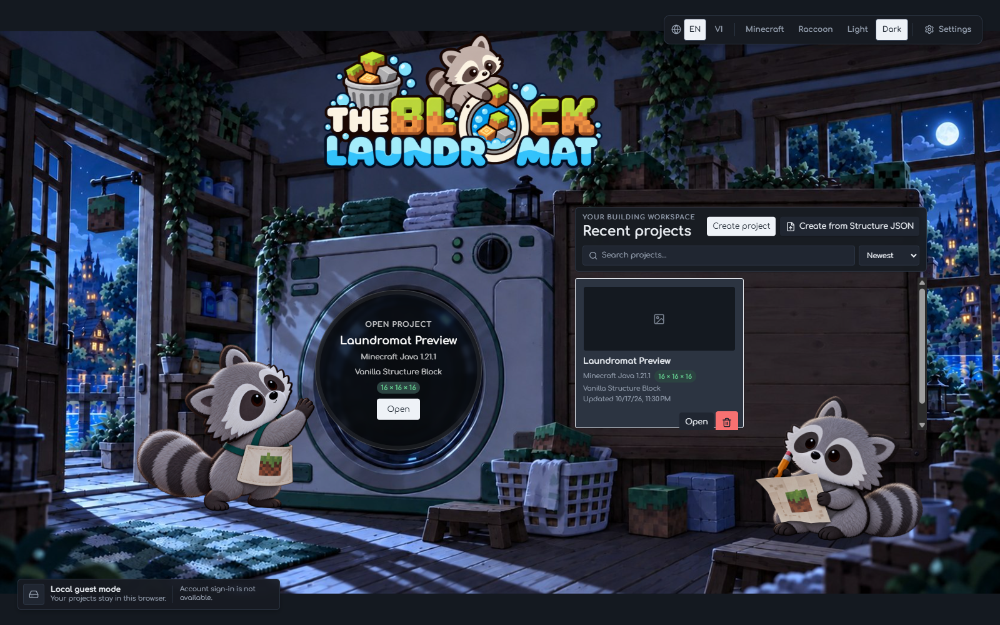
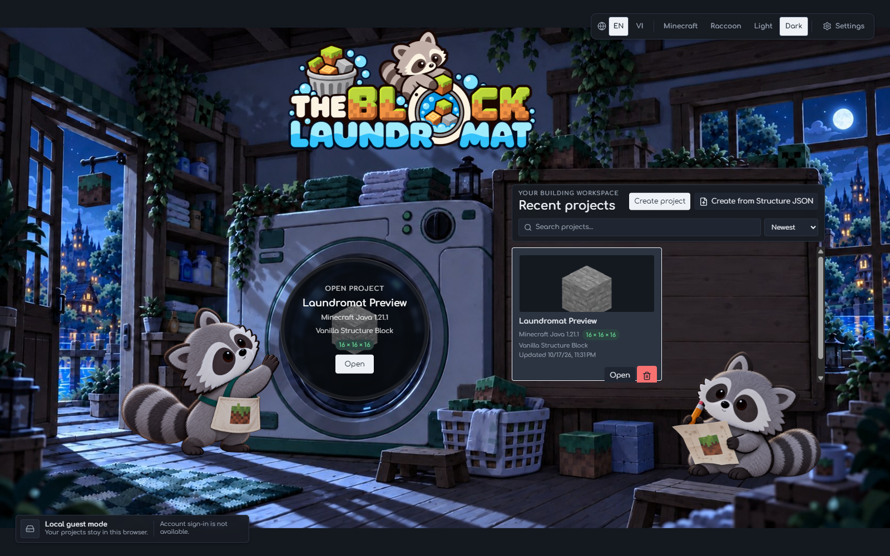

# Project Card Preview Review

This review checks that the Project Screen uses an existing renderer capture
inside its project card and keeps the card actions visible.

## Captures

Before the editor capture exists, the card uses its neutral preview surface:

After one Stone block is placed and saved through the existing 3D editor, the
card shows the project's real 256 x 144 renderer capture:

## Browser Check

- Ran against the local app at a 1600 × 1000 desktop viewport in a disposable
  browser context.
- Created a temporary project, opened it through the Project Screen, placed one
  Stone block using the 3D editor, then returned through the app's existing
  navigation.
- Confirmed the card preview loads a 256 x 144 image from a blob URL backed by
  the existing IndexedDB preview store. The captured image is not part of the
  project JSON or summary record.
- Confirmed the Open and Delete actions are visible in the populated card.
- The disposable browser context was closed after capture. No project data from
  the user's browser profile was accessed.
