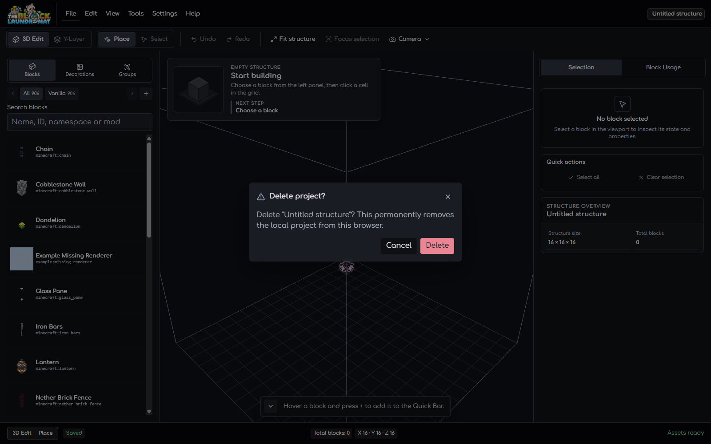
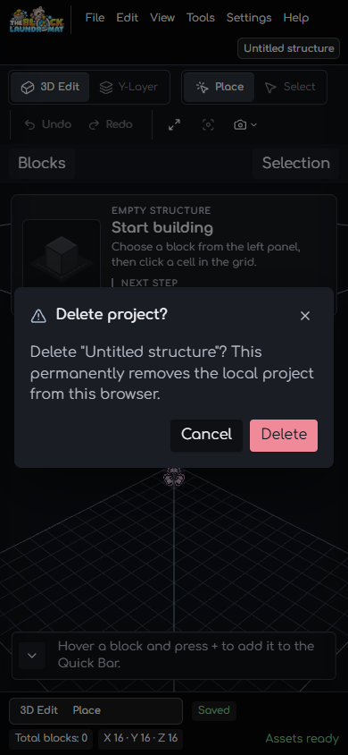

# Shared alert dialog motion review

- **Capture date:** 2026-10-17
- **Browser:** Chrome headless through a local CDP session
- **Project data:** Disposable local project; every confirmation was cancelled.

The shared `DialogService` alert portal now uses the Workspace dialog and
backdrop motion contract. The desktop capture shows the real Delete Project
confirmation at 1600 × 1000. The narrow capture shows the same confirmation at
390 × 844.

## Browser checks

- At desktop size, the dialog host used `workspace-dialog-in` at 180 ms and the
  backdrop used the shared fade-in. On cancel, the host used
  `workspace-dialog-out`; its `animationend` event arrived after 128 ms and the
  overlay was then disposed.
- Theme palette sampling retained the same motion and showed each theme's
  paired surface/text values: Minecraft `#4D4941` / `#FFF3DC`, Raccoon `#42474C` /
  `#F5F4F1`, Light `#FAFAFA` / `#171717`, and Dark `#1A1D24` / `#F2F3F5`.
- At 390 × 844, the dialog stayed within the viewport (x 16–374, width 358 px)
  and the document width remained 390 px.
- With `prefers-reduced-motion: reduce`, computed dialog and backdrop animation
  durations were 1 ms. The dialog's exit event arrived after 15 ms and the
  overlay was removed.

The UX/UI prompt catalog and its source repository were reviewed for interactive
motion examples. The implementation keeps the project's established timing,
theme tokens, and animation ownership rather than adding a dependency or a new
motion system: [Lucian UX/UI Prompt](https://lucianlabs.dev/uxui-prompt/),
[source repository](https://github.com/Seokwoooo/lucian-uxui-prompt).
