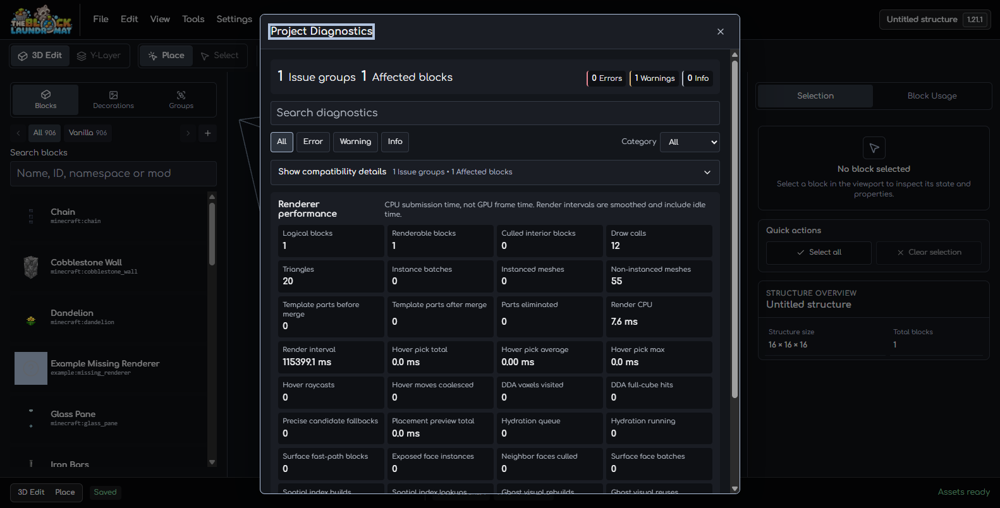
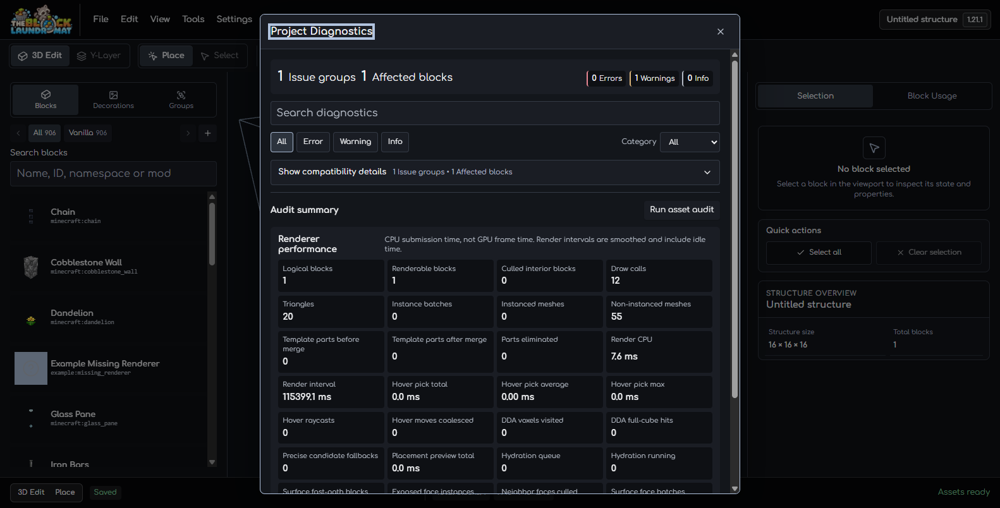

# Project Diagnostics Hierarchy Review

Captured on 2026-10-17 at a 1582 × 804 desktop viewport in the existing local
editor tab. The open project has one `example:missing_renderer` block. The
project and saved preferences were left unchanged; the asset audit was not run.

## Dark theme before and after

Before, the renderer metrics grid came before the Asset Audit section, pushing
the `Run asset audit` action below the initial dialog viewport. After, the
asset audit summary and action follow the issue findings, with the renderer
metrics below them. The existing search, filters, audit progress, cancellation,
report, and metric content remain in the same sections.

The one compatibility warning remains collapsed under its existing disclosure.
This review covers the dialog's default desktop hierarchy; narrow and audit
progress states remain covered by their existing checks.
