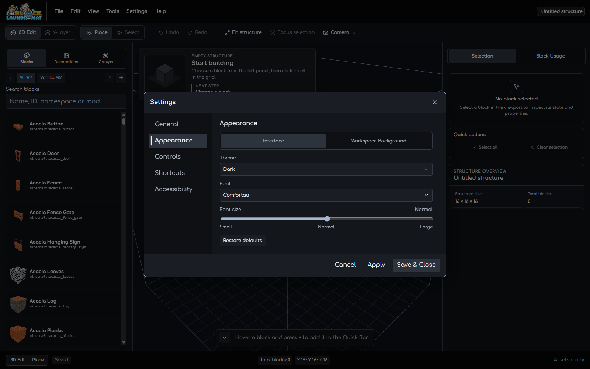
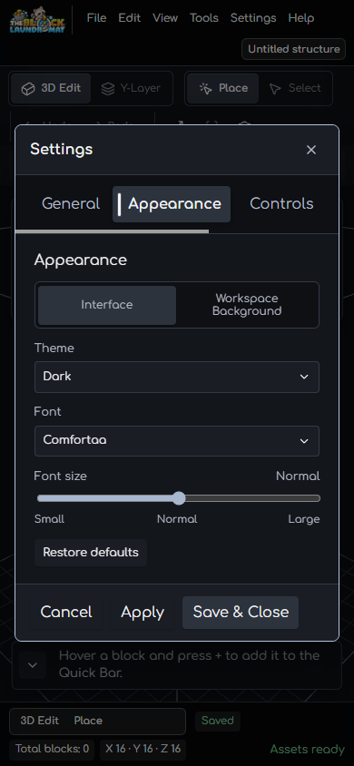

# Workspace dialog host transitions

- **Capture date:** 2026-10-17
- **Browser:** Chrome headless through a local CDP session
- **Project data:** Isolated blank project; the Settings dialog was closed without applying changes.

The editor shell removes these modal components through `@if`: Settings,
Controls & Shortcuts, Asset Manager, Project Diagnostics, Structure JSON Import
and Export, Structure NBT Export, and the missing-assets dialog. Their
conditional hosts now own the fade lifecycle, so Angular keeps the complete
backdrop mounted through exit. Dialog panels retain their existing entrance
movement where they already provide it.

## Browser checks

- At 1600 × 1000, the Settings host entered with
  `workspace-overlay-fade-in` (180 ms) while its panel kept
  `workspace-dialog-in`. On close, the host used `workspace-overlay-fade-out`
  (120 ms), stayed mounted during exit, then detached after the animation event.
- At 390 × 844, the Settings dialog stayed within x 16–374 (358 px wide) and
  the document width remained 390 px.
- With `prefers-reduced-motion: reduce`, the computed host animation duration
  was 1 ms and the dialog closed within the 100 ms browser observation window.

The same host classes are used on each conditional modal component listed
above. They animate only the Angular overlay; they do not change dialog data,
focus handling, project state, or renderer behavior.
