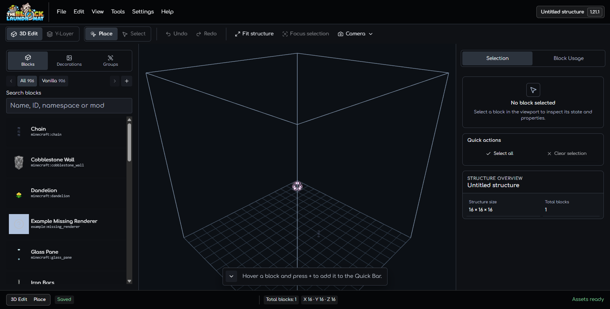
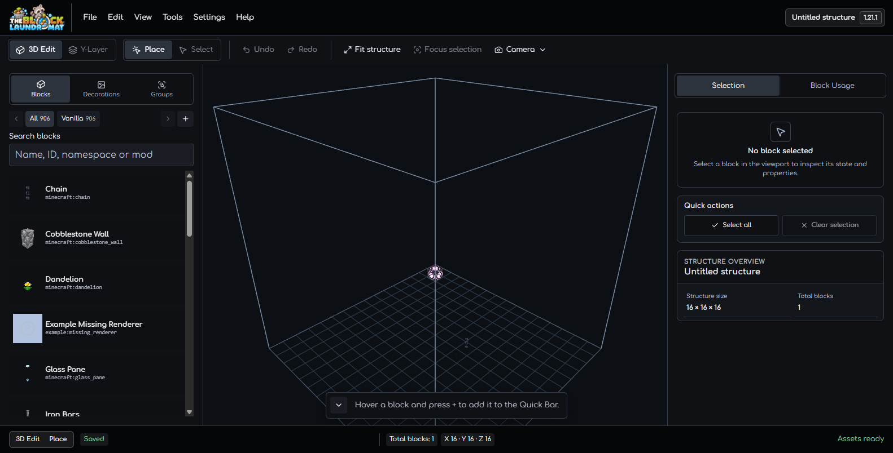
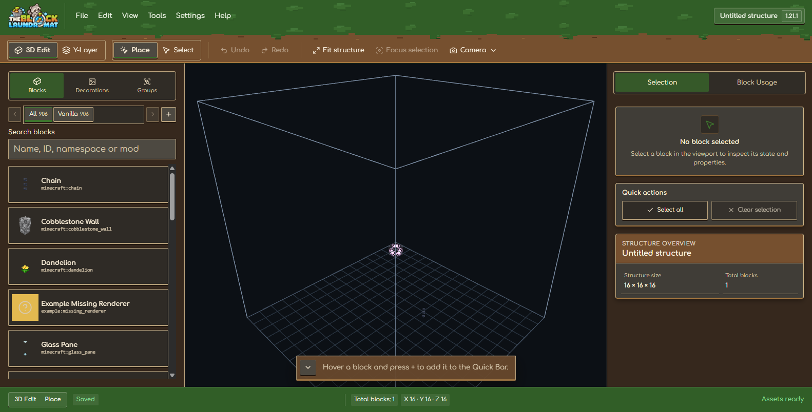
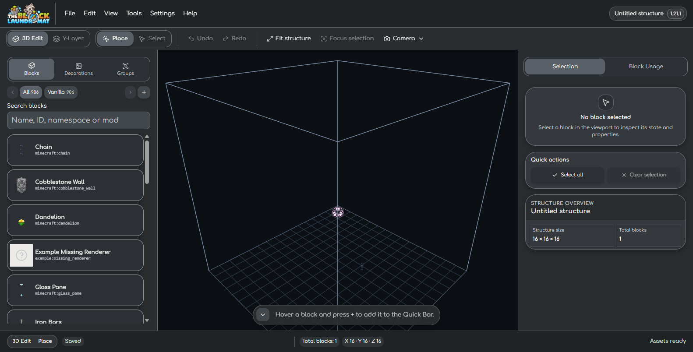
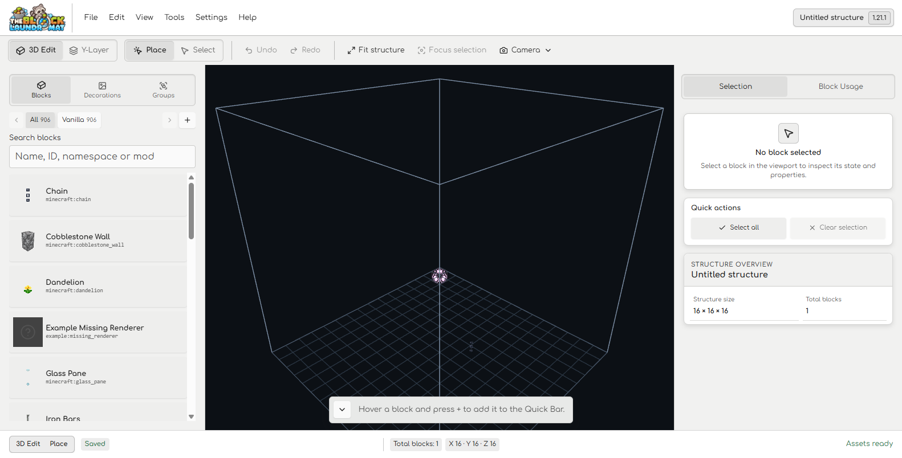

# Selection Inspector Action Surface Review

Captured on 2026-10-17 at a 1582 × 804 desktop viewport in the existing local
editor tab. The Selection inspector has no block selected; the open project was
left unchanged.

## Dark theme before and after

The before capture shows the Quick Actions card and its secondary buttons using
the same `#0e1014` fill. The card now uses the regular panel surface (`#13161b`)
while its buttons keep the darker control surface and gain a visible `#343a45`
frame, so both enabled and disabled actions read as controls inside the card.

## Other theme checks

These captures check that the card and buttons remain legible in the other
Workspace themes after the Dark-only surface correction. The existing saved
theme was restored to Dark after capture.

| Theme     | Capture                             |
| --------- | ----------------------------------- |
| Minecraft |  |
| Raccoon   |  |
| Light     |      |

This review closes only the nested Quick Actions surface issue. Full Workspace
visual acceptance remains open.
