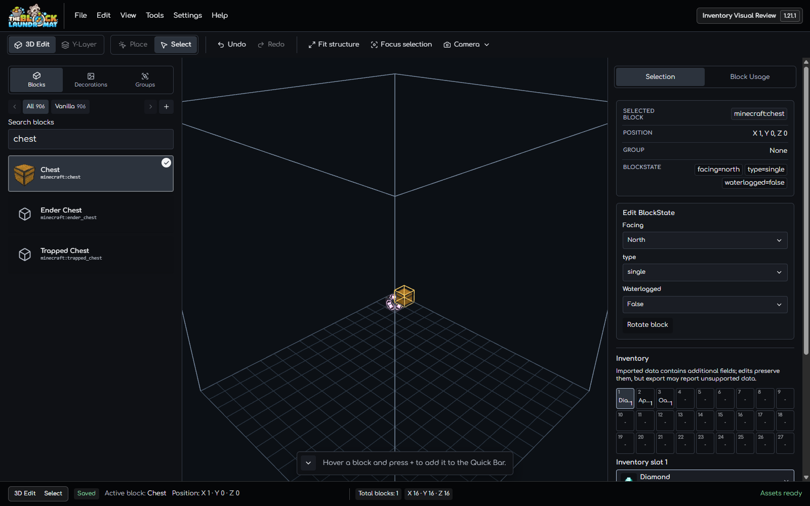
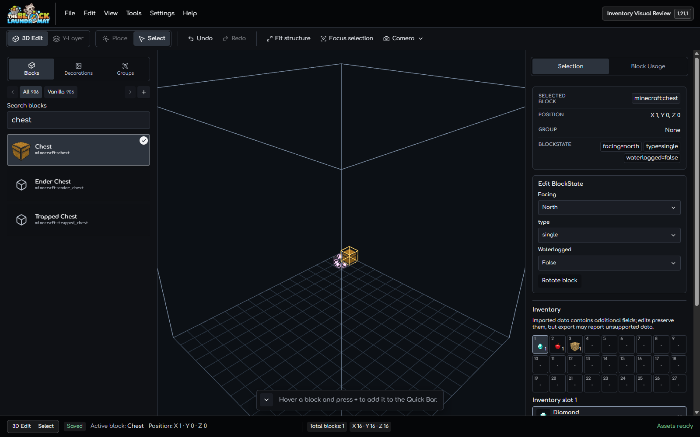

# Inventory Item Thumbnail Review

This review checks the populated inventory grid for a selected vanilla chest.
It compares the current text-only slots with real item thumbnails from the
existing item visual cache.

## Captures

Before, item names are truncated inside the narrow 9-column slots:

After, the grid uses the real Diamond, Apple, and Oak Planks renderer previews:

## Browser Check

- Used separate disposable browser contexts at a 1600 x 1000 viewport.
- Created the same temporary project, placed and selected a Minecraft 1.21.1
  chest, and added Diamond, Apple, and Oak Planks through the existing slot
  picker.
- Confirmed the 27-slot inventory keeps all three contents, slot numbers,
  counts, labels, and the existing searchable item editor.
- Confirmed all three slot images load from the existing item visual renderer.
  The previews are presentation-only and do not change inventory data.
- Closed both browser contexts after capture. No project data from the user's
  browser profile was accessed.
