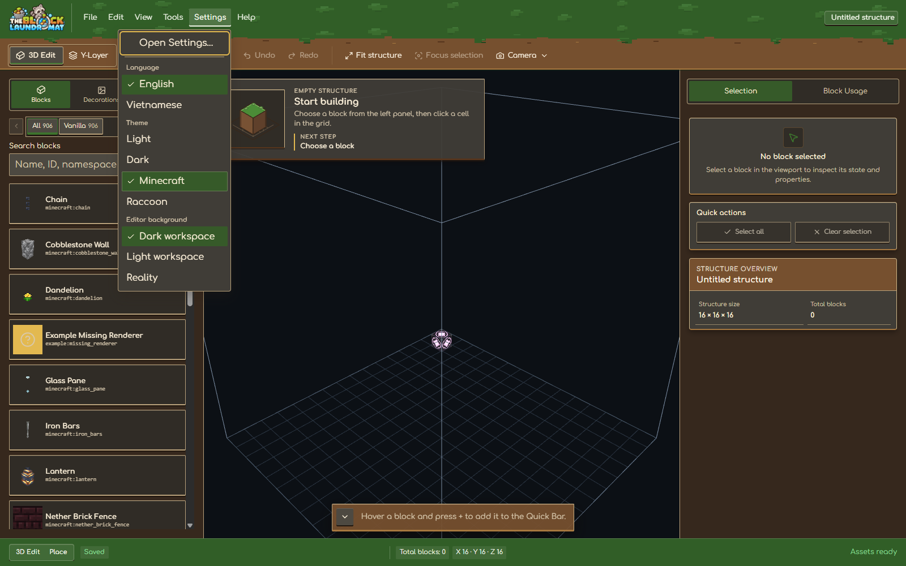
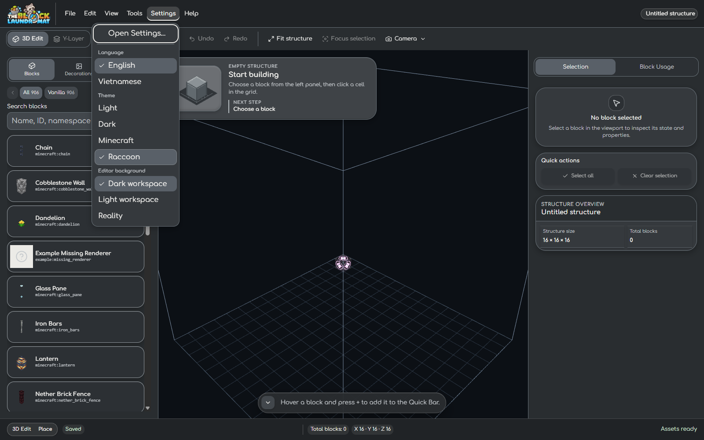
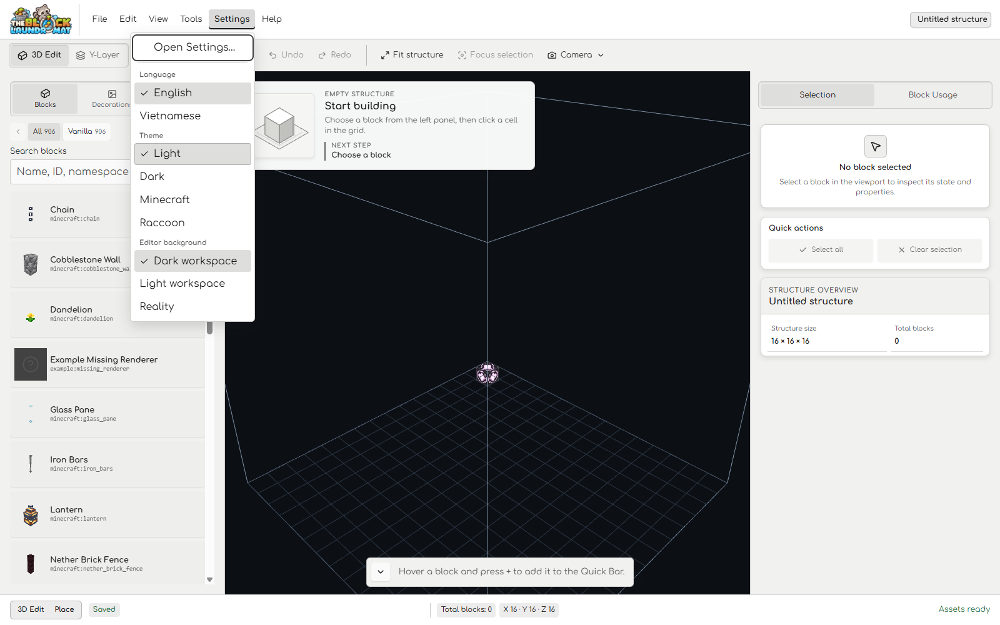
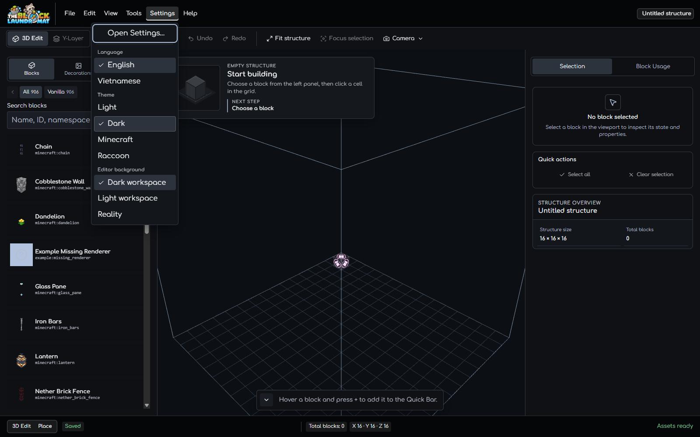

# Workspace Menu Feedback Review — 2026-10-17

## Scope

Menu items now transition their background and text color, move down briefly
when pressed, and keep a checked item's selected fill while it is hovered. A
fine inset edge distinguishes hover from the persistent checked state.

## Browser checks

- Chrome headless at 1600 × 1000, using an isolated blank structure. The menu
  theme was restored to Dark after the review; no project data was changed.
- In Minecraft, Raccoon, Light, and Dark, hovering the checked theme choice
  retained its selected background and foreground while adding the hover edge.
- Menu item background, color, shadow, and press feedback use the 120 ms fast
  motion token. Pressing the checked theme item moved it down by 1 px.
- With `prefers-reduced-motion: reduce`, the transition duration resolved to
  1 ms.
