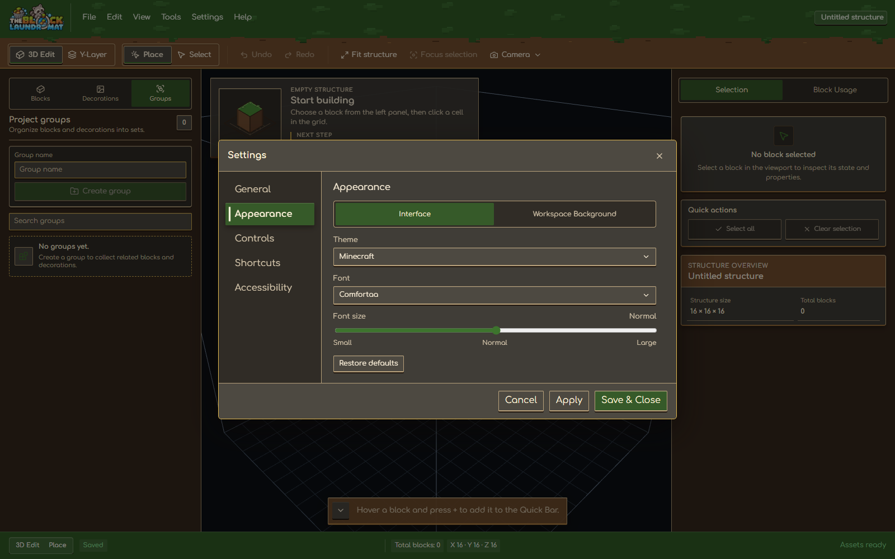
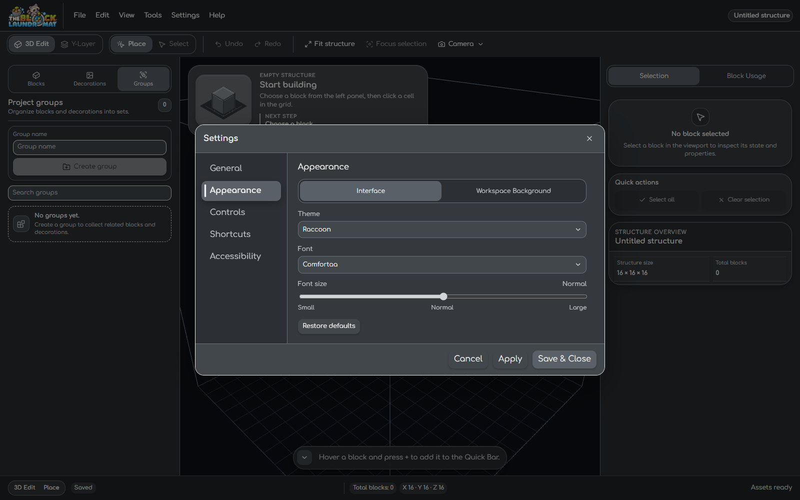
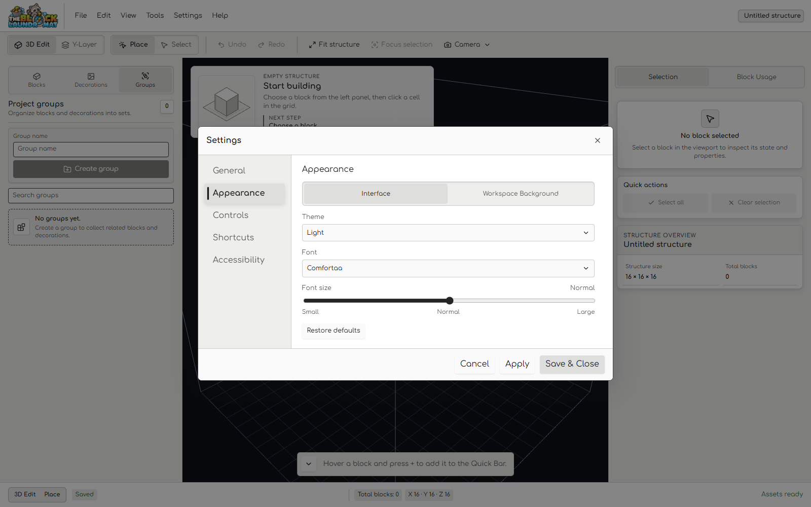
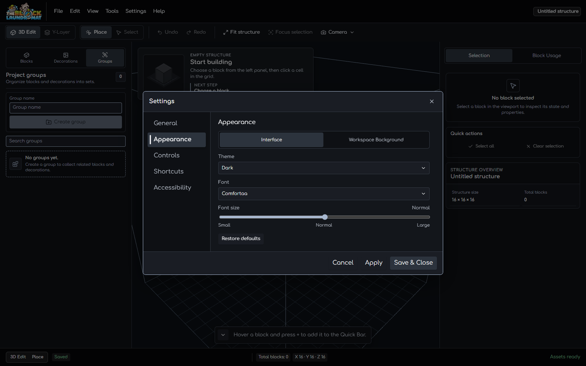

# Shared Workspace Tab Surface Review — 2026-10-17

## Scope

The shared `.ui-tab-strip` now gives the selected tab its own surface and text
state. It no longer animates a separate surface behind the tab. The editor's
3D/Y-Layer and Place/Select segmented controls retain their separate track.

The review covers the three Workspace sidebar tabs and the two Appearance tabs
in Settings. The shared style also serves sign text, Asset Manager, Structure
JSON Import, Shortcuts, and External AI tabs.

## Browser checks

- Chrome headless, 1600 × 1000, using an isolated blank structure. No project
  data was changed.
- In Minecraft, Raccoon, Light, and Dark, each of the three sidebar tabs and
  both Settings Appearance tabs displayed the selected surface and foreground
  from the active theme tokens.
- Switching Appearance tabs emitted `background-color` and `color`
  transitions on the tab buttons. The tab strip had no `::before` surface or
  translation transform.
- With `prefers-reduced-motion: reduce`, the tab transition duration resolved
  to 1 ms and the selected surface updated immediately.
